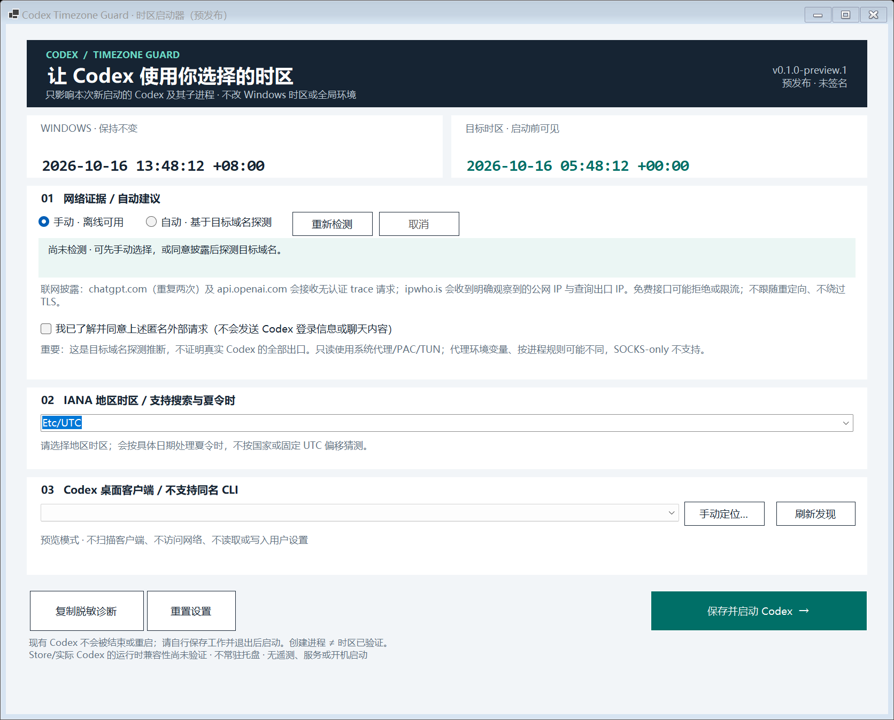

# Codex Timezone Guard

**只给 Codex 桌面端设置时区，不改 Windows 全局时区。**

一个面向普通用户的 Windows 中文启动器：按目标域名探测网络出口、自动推荐
IANA 地区时区，也支持离线手动选择，然后以独立 `TZ` 环境启动 Codex。
项目参考 [codexTimeZoneRev](https://github.com/iUshio/codexTimeZoneRev) 等开源实现，
专注于规则代理下的检测边界与安全隔离，不集成皮肤、账号用量或代理内核。

> **预发布提示**：这是独立社区工具，不是 OpenAI 官方产品。
> 自动检测是基于目标请求的建议，不是 Codex 全部流量出口的证明。
> 真实 Codex/Store 安装渠道与运行时时区需要用户安全退出后验证；未验证项目
> 不宣称兼容。详细证据见 [验证报告](docs/verification.md)。

## 下载

请在 [GitHub Releases](https://github.com/xndxyy/codex-timezone-guard/releases)
选择标注 **Pre-release** 的版本：

- `CodexTimezoneGuard-win-x64.exe`：便携单文件，双击运行，不需要自行安装 .NET。
- ZIP：同一 EXE 加许可证、隐私说明和基础验证报告。
- `SHA256SUMS.txt`：核对文件完整性，具体步骤见 [安全说明](SECURITY.md)。

没有商业代码签名，Windows 可能显示“未知发布者”。请先核实下载来源和校验值；
不能确认就不要运行。**不需要关闭杀毒、修改安全设置或授予管理员权限。**

首版面向 **Windows 11 x64**。Windows 10 x64 尚未实机验证；不提供 ARM64、
macOS、Linux 或浏览器扩展包。IANA 转换依赖系统可用的时区/全球化支持，老旧或
特殊配置的系统可能不支持，程序不通过修改系统设置来补救。

## 小白使用：三步

1. **保存工作并正常退出已运行的 Codex。** 启动器不会强制关闭它，已运行进程
   不会因为保存了时区设置而自动改变。
2. 打开本工具，确认首次联网说明后进行**自动检测**，或者切换到**手动选择**。
   检查 IANA 时区和时间预览，例如 `America/Los_Angeles`。
3. 确认检测到的 **Codex 桌面客户端**，点击**保存并启动**。

第一次可以先只选择时区和查看预览，不必立即启动 Codex。检测失败时仍可手动使用。



*上图是实际 Windows Forms 的离线绘制预览，不是公网探测或真实 Codex 运行时生效证明。*

## 哪些东西会改变？

| 对象 | 行为 |
|---|---|
| 本次启动的新 Codex 桌面进程 | 收到所选 `TZ`，遵从该变量的运行时使用它 |
| Codex 启动的终端、Python、Node 等后代 | **可能继承 `TZ`**，这是本项目 A 方案的明确边界 |
| Windows 时区、系统时钟、用户/机器环境变量 | 不修改 |
| 独立打开的浏览器、微信和其他应用 | 不修改 |
| 系统代理、规则模式、节点、订阅、DNS | 不修改 |
| 已运行的 Codex 或共享后台 daemon | 不接管、不结束，可能仍使用原环境 |

不支持把任意 `codex.exe` 当作桌面端：CLI、IDE 插件、ChatGPT 桌面端与浏览器
不在本项目目标内。手动选文件也必须通过桌面身份检查。

## 为什么规则模式不能只查一个 IP 网站？

代理可能让 IP 查询网站直连，却让 Codex 目标域名走另一个节点。因此检测流程是：

```text
读取目标 URL 的系统代理/PAC 路由（只读）
  → 请求目标域名 trace，重复观察出口
  → 对明确观察到的 IP 做地理定位
  → 一致且有效时推荐 IANA 时区
  → 失败/冲突时提示，保留手动选择
```

- 不把普通 IP 网站返回的地址悄悄当作 Codex 出口。
- 不根据节点名称、国家名或 Cloudflare 数据中心代码猜城市时区。
- 显式代理/PAC 失败时，不静默绕过改成直连。
- 支持范围是系统 HTTP/HTTPS 代理、PAC、直连和现有 TUN；SOCKS-only 配置不能
  冒充已支持。如代理软件已有 HTTP/mixed 入口，可由用户自行选择相应系统设置。

**仍有边界**：检测由启动器发起。按进程分流、IPv4/IPv6 差异、自动节点切换、
负载均衡和共享后台进程都可能与真正 Codex 请求不同。`/cdn-cgi/trace` 也不是
稳定的官方 Codex API，可能被移除、返回 403/404 或挑战页。这些情况会如实失败，
不绕过验证、不修改其他程序来制造“自动成功”。

## 隐私

自动检测在首次联网说明确认后，向固定目标 trace 端点和 `ipwho.is` 发送必要的
匿名请求。第三方会收到连接出口 IP；地理服务还会收到明确查询的 IP。
**不读取 Codex 令牌、聊天内容或账号密码，不拦截对话，不收集遥测。**
默认不在设置和诊断中保存原始公网 IP。完整说明见 [PRIVACY.md](PRIVACY.md)。

## 常见问题

**自动检测失败怎么办？** 先使用手动时区。确认目标域名可访问、系统代理/PAC
可用；不要为使用本工具把全部应用强制改成全局代理。

**切换节点后会自动改已运行的 Codex 吗？** 不会。保存工作后正常退出，重新检测
再从启动器打开。首版不常驻改时区或自动中断你的任务。

**启动时为什么暂时关不了窗口？** 正在创建、验证或清理本次新进程时，窗口会
提示等待，避免留下挂起进程。完成后可正常关闭；网络检测阶段仍可取消或关闭。
这不抵御强制结束启动器、系统强制终止或断电。

**Store 版提示身份或权限问题？** 本工具不会接管 WindowsApps 权限或注册调试器。
请参考官方客户端安装/修复途径；本工具不保证所有 Store 版本可直接启动。

**为什么 Codex 安装目录里有 `ChatGPT.exe`？** 某些 Codex Store 包内部沿用这个
文件名。本工具按 Codex 包/桌面身份区分，不仅看 EXE 名字；不支持把独立的
ChatGPT 桌面产品当成 Codex 使用。

**显示“已启动”是否代表全部组件已切换？** 不是。Windows 原生 API 与共享后台
可能使用系统值。请按 [手工验收](docs/manual-acceptance.md) 分开验证日期运行时，
不要用模型回答的“现在几点”作为唯一依据。

**如何恢复/卸载？** 正常退出 Codex，下次从原官方快捷方式启动即可恢复其原有
环境；本工具从未改系统时区。退出并删除本工具 EXE 与
`%LOCALAPPDATA%\CodexTimezoneGuard` 设置目录即可卸载，不要删除 Codex 的数据。

## 从源码构建

要求 Windows x64 与 `global.json` 指定的 .NET 10 SDK，不要求 Python、Node、
Flutter、Rust 或第三方 NuGet 应用依赖。先克隆本仓库，然后：

```powershell
.\scripts\verify.ps1
.\scripts\build.ps1
```

构建脚本先验证，再发布 self-contained 单文件包并运行打包后的离线自检，生成
`artifacts/release/` 下的 EXE、ZIP、SHA-256 与收据。缓存、临时文件与测试设置
被重定向到仓库 `.cache/`，不写全局设置。分发为单文件不意味着零落盘：.NET
原生运行时可能在首次启动时解包到本地临时目录。

代码分层：

```text
src/CodexTimezoneGuard.Core/    时区、配置、网络安全、发现与启动
src/CodexTimezoneGuard/         中文 Windows Forms 界面与诊断模式
tests/                         确定性测试与独立环境探针
scripts/                       本地验证与打包
docs/                          技术设计、证据、兼容性与验收
```

构建与测试不会自动启动/终止真正的 Codex。GitHub Actions 使用同一套脚本，不需要
Codex 账号；测试通过不代表全部真实客户端版本已验证。

## English summary

A Windows-only, Chinese-first Codex **desktop** launcher. It suggests an IANA
timezone using destination-aware, anonymous egress probes, or accepts a manual
selection, and starts a validated new client with a child-process-local `TZ`.
Windows/global environment and proxy rules are unchanged. Codex descendants may
inherit `TZ`; already-running/shared processes may retain their previous state.

This is an independent prerelease, not an OpenAI product or an access guarantee.
Probes are recommendations, not proof of Codex's per-process route. Manual mode
remains available. See PRIVACY.md, SECURITY.md and the verification report.

## 许可证与致谢

[MIT](LICENSE)。感谢 [iUshio/codexTimeZoneRev](https://github.com/iUshio/codexTimeZoneRev)
和 [leihen08/codex-timezone-launcher](https://github.com/leihen08/codex-timezone-launcher)
提供的公开实现与边界说明。平台与上游说明见 [THIRD_PARTY_NOTICES.md](THIRD_PARTY_NOTICES.md)。
